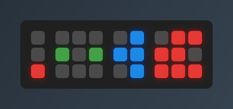
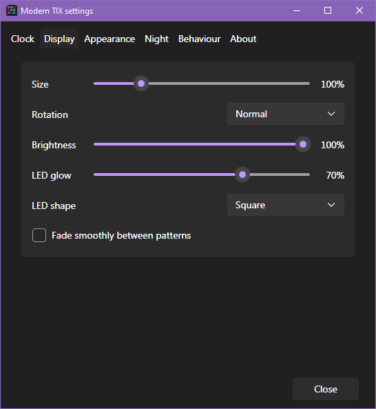
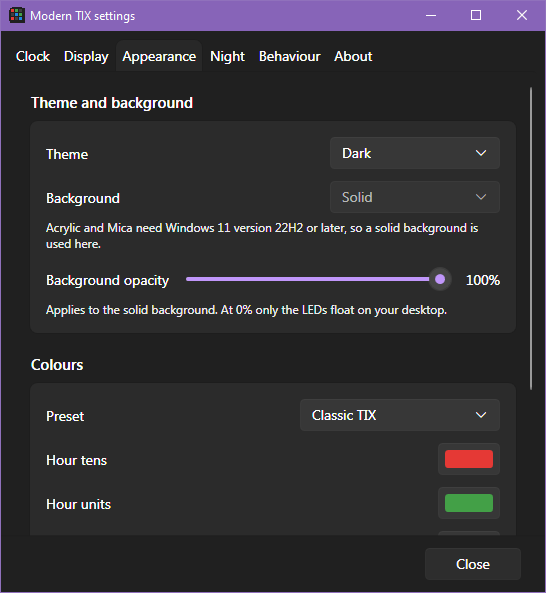

# Modern TIX

A modern Windows 10/11 take on the TIX LED clock. The original TIX was made by Cube Root Labs; this is an
independent homage and isn't affiliated with them.

> **Made with AI:** Modern TIX was created by Ben Somner using Claude Code, Anthropic's AI coding assistant.
> The code, icon and documentation were written by the AI from Ben's design ideas and feedback, then tested
> and refined together.



## How to read it

Count the lit squares in each block to read the time:

| Block | Squares | Shows |
|---|---|---|
| 1 | 3 | Hour tens |
| 2 | 9 | Hour units |
| 3 | 6 | Minute tens |
| 4 | 9 | Minute units |

The clock above shows 12:47: 1, 2, 4 and 7 lit squares. The pattern reshuffles every 1 s, 4 s (default) or 60 s,
but the count only changes with the time.

## Download

Get the latest version from the [Releases page](../../releases/latest). There are two downloads:

| Download | Size | Needs |
|---|---|---|
| `ModernTIX-<version>-win-x64-standalone.zip` | About 67 MB | Nothing; .NET is built in |
| `ModernTIX-<version>-win-x64.zip` | Under 1 MB | The [.NET 10 Desktop Runtime](https://dotnet.microsoft.com/download/dotnet/10.0) |

Extract the zip anywhere and run `ModernTIX.exe`. Windows may show a SmartScreen warning because the app isn't
code-signed; choose **More info → Run anyway**.

## Screenshots

| Light theme | Round LEDs, no background, Ocean colours | Warm night colours, 60% background |
|---|---|---|
|  |  |  |

| Settings: Display | Settings: Appearance |
|---|---|
|  |  |

## Using it

- **Move:** drag the clock. **Resize:** Ctrl + scroll over it.
- **Quick options:** right-click the clock (24-hour, pattern speed, rotation, always on top, lock position,
  Settings, About).
- **Rotate:** normal, 90° clockwise, 180° or 90° anticlockwise. The clock turns around its centre and stays on screen.
- **Tray icon:** left-click shows or hides the clock; right-click for click-through, Settings and Exit.
- **Settings** (tabs for Clock, Display, Appearance, Night, Behaviour and About): colours per block and for unlit
  squares, colour presets, brightness, LED glow strength (0–100%), square or round LEDs, smooth fades between
  patterns, size, theme (Match Windows / Light / Dark), background (Acrylic / Mica on Windows 11 22H2+, otherwise
  solid), background opacity (0% leaves just the LEDs floating), hover tooltip (with or without the date), start
  with Windows.
- **Night dimming:** a lower brightness between two times, e.g. 22:00 to 07:00.
- **Click-through:** the mouse passes through the clock to whatever is underneath. It's only in settings and the
  tray menu, never the clock's own menu, so it can always be turned off again.
- **Full-screen apps:** the clock hides while a full-screen game, video or presentation is on its monitor.

Switching between a Solid background and Acrylic/Mica restarts the clock, as they need different kinds of window.

### Where settings are kept

Settings are stored in `%APPDATA%\ModernTIX\settings.json`. "Start with Windows" adds a `Modern TIX` entry under
`HKCU\Software\Microsoft\Windows\CurrentVersion\Run`.

**Portable mode:** if `ModernTIX.settings.json` exists next to `ModernTIX.exe`, the app uses that instead, so the
folder can be copied to a USB stick or synced between PCs. Turn it on or off in Settings → Behaviour, which moves the
settings file for you. The folder has to be writable (not Program Files). "Start with Windows" still uses the
registry on each PC.

## Building

Needs the .NET 10 SDK.

The small build, which needs the .NET 10 Desktop Runtime to run:

```
dotnet publish -c Release -o publish
```

The standalone build, a single exe with .NET built in (needs nuget.org as a package source, or add
`--source https://api.nuget.org/v3/index.json`):

```
dotnet publish -c Release -r win-x64 --self-contained true -p:PublishSingleFile=true -p:EnableCompressionInSingleFile=true -p:IncludeNativeLibrariesForSelfExtract=true -o publish-standalone
```

## Planned features

- Multiple clocks for different time zones, each with an optional short time zone label (e.g. UTC, EST, JST).
